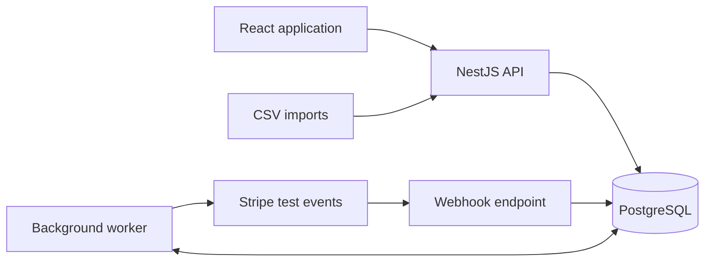

# ReturnLedger

A refund reconciliation and investigation platform for online merchants.

ReturnLedger compares approved returns with recorded refunds, explains discrepancies, and preserves the history of investigation decisions.

> **Project status:** Planning and repository setup. The application has not been scaffolded yet. Features and architecture below describe the intended implementation.

## The problem

Approved returns and payment-provider refunds often live in separate systems. A merchant may approve a refund that is never completed, refund too little, or accidentally refund too much. Reviewing spreadsheets manually makes these differences difficult to investigate and track.

ReturnLedger brings the records into one workflow:

**Import records → reconcile amounts → investigate discrepancies → record a resolution → preserve history.**

For example, an approved **$40.00** return with a recorded successful refund of **$25.00** produces a **$15.00 shortfall**, with linked records and an investigation timeline.

## Planned MVP

- Dashboard with expected refund totals, effective refunded totals, and unresolved exceptions.
- Searchable returns table with filters and pagination.
- CSV import with previews, row validation, and duplicate detection.
- Manual reconciliation with saved run results.
- Investigation details, notes, assignments, and resolution history.
- Stripe test-mode webhooks with durable storage and background processing.
- Sign-in, organization ownership, and server-side permissions.
- Automated checks and a protected hosted demonstration.

The first release targets **one merchant organization**, **USD**, and **one approved return per order**.

Automatic refund execution, money movement, payout reconciliation, currency conversion, and full accounting are outside the MVP.

## Planned technology stack

| Layer | Technology |
| --- | --- |
| Frontend | React, TypeScript, Vite |
| Backend | NestJS, TypeScript |
| Database | PostgreSQL |
| Database access | Prisma |
| Integration | Stripe SDK and CLI in test mode |
| Background processing | Separate worker using a PostgreSQL inbox |
| Browser testing | Playwright |
| Continuous integration | GitHub Actions |

Compatible runtime and dependency versions will be pinned when the applications are scaffolded.

## Architecture

The backend will use a **modular monolith**: one codebase with separate modules for identity, returns, imports, refunds, reconciliation, investigations, and audit history.

The API and worker will run as separate processes using the same business services.



The webhook endpoint will verify and save events before acknowledging delivery. The worker will apply refund updates and ledger effects transactionally, with retries and duplicate protection.

## Reconciliation rules

Amounts will be stored as integer minor units: **$40.00 = 4000 cents**.

```text
difference_minor = expected_minor - effective_refunded_minor
```

- A positive difference represents a refund shortfall.
- A negative difference represents an over-refund.
- Pending refunds are displayed separately from completed refunds.
- Due time distinguishes an awaiting refund from an overdue missing refund.
- Failed or canceled refunds do not count as completed refund movements.
- Confirmed reversals preserve the original ledger entry and append a compensating entry.
- Repeated imports or events must not duplicate financial effects.

Planned acceptance examples:

| Return | Expected USD | Refunded USD | Result |
| --- | ---: | ---: | --- |
| R-001 | 30.00 | 30.00 | Matched |
| R-002 | 50.00 | 0.00 | Missing refund after due time |
| R-003 | 40.00 | 25.00 | Under-refunded by 15.00 |
| R-004 | 20.00 | 40.00 | Over-refunded by 20.00 |

**Investigation status and financial findings are separate.** Resolving an investigation records a decision; it does not change refund amounts or erase the discrepancy.

## Repository layout

The current repository contains this README and the Git ignore configuration.

The intended layout after scaffolding is:

```text
Return-Ledger/
  apps/
    web/              # React application
    server/           # NestJS API, worker, and Prisma schema
  packages/
    contracts/        # Shared API contracts
  tests/
    e2e/              # Browser workflow tests
    fixtures/         # Synthetic test records
  infra/              # Deployment configuration
  docs/               # Architecture and implementation guides
  .github/
    workflows/        # CI configuration
  .gitignore
  README.md
```

## Development setup

There are currently no install, development, migration, or test scripts to run.

Before scaffolding, prepare:

- Git.
- A compatible Node.js LTS release with npm.
- PostgreSQL, installed locally or provided through Docker.
- Stripe CLI for the later integration milestone.

The first implementation checkpoint is a React page that displays the response from a NestJS health endpoint.

Once the applications exist, this section will document exact commands for dependency installation, environment configuration, database migrations, seed data, local startup, and tests.

### Environment files

Real environment files and private credentials are excluded by `.gitignore`.

When configuration is introduced:

1. Commit example files such as `.env.example` with placeholders only.
2. Keep actual database credentials, Stripe API keys, and webhook signing secrets in local environment files or a secret manager.
3. Keep server secrets out of frontend environment variables.
4. Use synthetic records and Stripe test data during development.

Dependency lockfiles, Prisma migrations, and synthetic fixtures should be committed.

## Implementation roadmap

- [ ] Scaffold the web application and API; connect the health endpoint.
- [ ] Add the database schema, migrations, organization ownership, and sign-in.
- [ ] Seed the four sample returns and implement reconciliation rules.
- [ ] Build the investigation interface and audit history.
- [ ] Add validated CSV previews and atomic imports.
- [ ] Implement verified Stripe intake, worker retries, and controlled replay.
- [ ] Add automated checks, deploy the demonstration, and document setup.
- [ ] Validate access isolation, backup restoration, and recovery before production use.

## Verification plan

The implementation will include tests for:

- Reconciliation examples, split refunds, due-time boundaries, and reversals.
- Duplicate imports and repeated or unordered provider events.
- Transaction rollback, worker restarts, and concurrent updates.
- Permissions and cross-organization access.
- The complete sign-in, import, reconciliation, investigation, and resolution workflow.

## Enterprise design goals

- Organization-scoped records and explicit role permissions.
- Immutable refund movement history and traceable reviewer decisions.
- Durable processing with retries and recovery.
- Reproducible reconciliation results with source evidence.
- Operational logs, monitoring, and tested database restoration.

These are implementation goals. Production readiness will be assessed against recorded acceptance evidence as the project develops.

